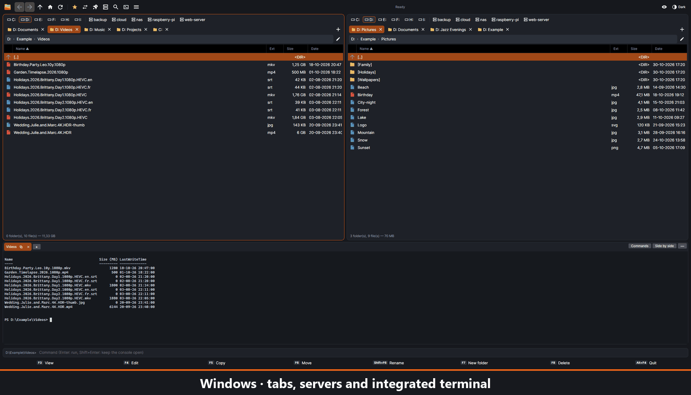
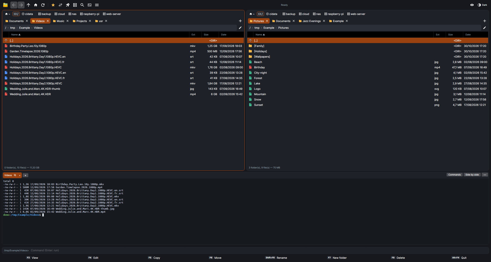
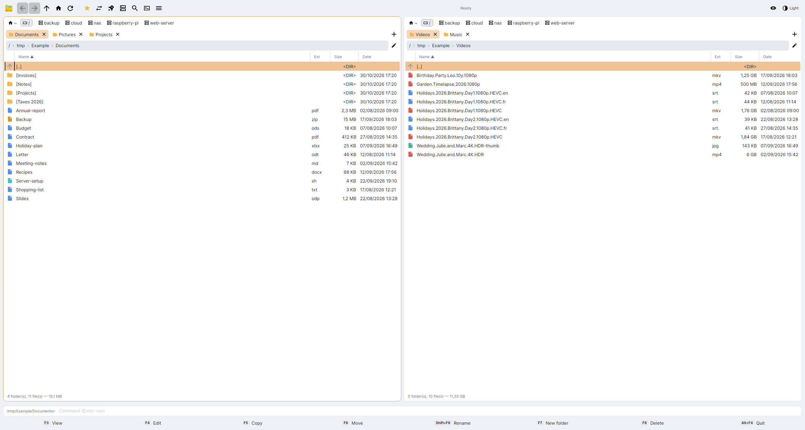
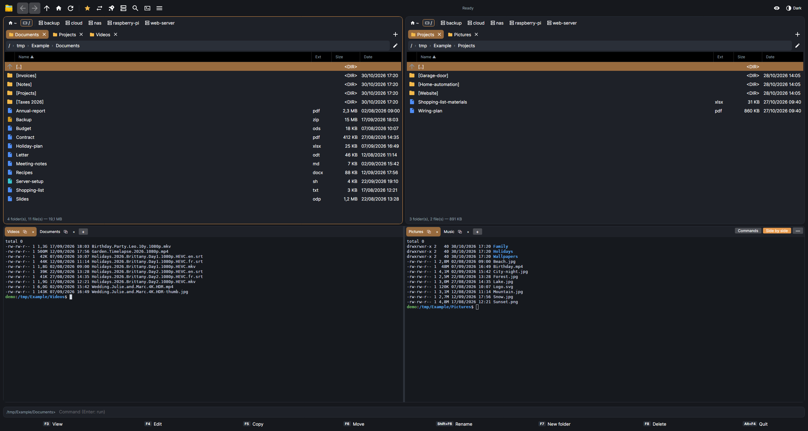
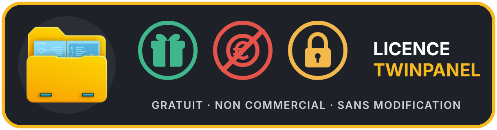

# TwinPanel

[Français](README.md) · **English**

A free, modern and complete two-panel file manager. For Windows, and for Linux as a beta. Interface in English and French.

- Two panels, lockable and renamable tabs, tab sets, quick view, folder tree, thumbnails, flat view
- Copy and move with a transfer queue, several transfers at once, resume after a cut, free space check
- SFTP, SCP, FTP, FTPS and WebDAV servers, used just like folders: connection manager, encrypted vault for passwords and keys, connection import
- Server files opened or edited directly, and sent back at each save
- Built-in terminal on the PC and on SSH servers: tabs, side by side, saved commands, search
- Built-in viewer (`F3`) and editor, printing
- Editable zip, 7z, tar and tar.gz archives, AES-256 encrypted zip, also on a server
- Search, duplicates, folder comparison, synchronization with profiles
- Multi-rename, also from media data; info and tags of audio, video and photo files
- Full properties: Unix permissions, owner and group, NTFS permissions
- Drag and drop, mouse menus, side buttons, middle click, `Ctrl` + wheel
- Settings backup, and encrypted synchronization of the configuration between your Windows and Linux machines, open tabs included
- Light or dark theme, customizable shortcuts, colors, icons and button bar
- Full built-in guide (`F1`), with FAQ and tips



## Download

**[TwinPanel for Windows](../../releases/latest)** (installer).

**[TwinPanel for Linux, beta version](../../releases/tag/linux-v0.1.13-beta)**: `.deb` package for Debian and Ubuntu, `.rpm` package for Fedora, or AppImage. This beta has been tested on Debian 13 with KDE, and on Ubuntu 26.04 and Fedora 45 with GNOME: some defects may remain.

```
sudo apt install ./twinpanel_*_amd64.deb     # Debian, Ubuntu
sudo dnf install ./twinpanel-*.x86_64.rpm    # Fedora
```

With the AppImage: `chmod +x TwinPanel-*.AppImage`, then run the file. On Fedora 45, install OpenSSL 3 first: `sudo dnf install openssl3-libs` (the `.rpm` package does it by itself). On Ubuntu, the App Center does not show TwinPanel, as it only knows its own catalogue; uninstall it with `sudo apt remove twinpanel`.







> **“Windows protected your PC” message:** TwinPanel is free and not signed, because a signing certificate must be paid for every year. Windows therefore shows this message until the program is well enough known. Click **More info**, then **Run anyway**. Make sure the file comes from this page; its SHA-256 checksum is given with each version.

To request a feature or report a problem: open an [“Issue”](../../issues) on the TwinPanel GitHub page. See [`CONTRIBUTING.md`](CONTRIBUTING.md).

## The origin of this project (Why and how?)

This software was born from a very personal need. Since 2003, I have used the excellent **Total Commander** every day, and I find it absolutely brilliant. However, for my specific use, some features were missing or not entirely optimal.

So I decided to create **TwinPanel**, originally just for my own use and my wife's. After I showed it to friends who wanted to try it, they strongly encouraged me to share it and make it available to other potential users, because it could be of great service — even though other similar projects exist on the market.

### Complete transparency with you:

I want to be 100% honest with everyone: **I know absolutely nothing about programming and I speak no language other than French**.

**TwinPanel** came into being, was entirely coded and was translated into English thanks to the help of the artificial intelligence **Claude Code**. The AI guided me step by step to turn my needs into lines of code and to generate the English version of the software, so that it can reach as many people as possible.

The program is shared here as it is, wholeheartedly, with the sole aim of being useful. It is entirely free, but as you can read in the License section below, it remains protected to ensure it is never commercialized or distorted.

Welcome to all future TwinPanel users!

## Guide

What follows is the full guide. It is the same text as in the program (**F1** key).

<!-- guide -->
## Getting started

TwinPanel shows two folders side by side: you work in the **active panel**, the one with the blue outline, and most operations target the **other panel**.

### The screen

- At the top: the toolbar. The **≡** button gives access to all the commands.
- In each panel: drives and connections, tabs, the path, then the file list.
- At the bottom: the command line and the clickable F3 to F8 keys.
- Running transfers appear just above the command line.

### The five gestures to know

| Gesture | Result |
|---|---|
| `Tab` | Switch panel |
| `Enter` or double click | Open a folder or a file |
| `Backspace` | Go back to the parent folder |
| `Ins` or short right click | Mark a file |
| `F5` / `F6` | Copy / move marked files to the other panel |

If nothing is marked, operations apply to the file under the cursor.

To reach a file faster, just type the first letters of its name (`Esc` to cancel).

## The mouse

TwinPanel can be driven entirely with the mouse. Several gestures cannot be guessed: here is the full list.

### In the file list

| Gesture | Result |
|---|---|
| Left click | Choose the line |
| Double click | Open the folder or the file |
| Click the name of the line already chosen | Rename in the list (`Enter`: confirm, `Esc`: cancel) |
| Ctrl + click | Mark an item |
| Shift + click | Mark a range of items |
| Short right click | Mark or unmark the item |
| Right button held while dragging | Mark or unmark everything the mouse passes over |
| Right button held ½ second | Open the item menu (Cut, Copy, Paste…) |
| Middle click on a folder | Open it in a new tab, in the background |
| Double click on an empty part | Go back to the parent folder |
| Side buttons | Previous / next folder |
| Ctrl + wheel | Larger or smaller text (in thumbnails: image size) |
| Ctrl + middle click | Back to normal size |

Click on the name can be turned off in Options → Behavior.

### Drag and drop

Hold the left button on an item and move the mouse. If the item is marked, all marked items go with it.

You can drop it on a folder, on the other panel, on a tab, on a drive or connection button, or in another program (File Explorer, email…). The reverse direction from File Explorer works too. Dragged from a server or an archive to another program, the items are copied to the PC when you drop them (into a temporary folder), then given to that program; the wait depends on their size. Above 500 MB, use Copy / Paste instead. To go into a folder of the list, drop on its **name** (or its icon): a border shows it. On its other columns (Ext, Size, Date…), the files go into the folder shown in the panel. On Linux, it depends on the session type chosen at login:

- **X11 session**: drag and drop works both ways, from TwinPanel to another application and back;
- **Wayland session**: you cannot drop into another application. Dragging from another application into TwinPanel remains possible.

To find your session type, type `echo $XDG_SESSION_TYPE` in a desktop terminal. On KDE, you choose the session on the login screen, before typing your password. On GNOME (Ubuntu, Fedora), the session is always Wayland.

| When dropping | Result |
|---|---|
| No key | “Copy here / Move here” menu, or copy, or move: your choice in Options → Behavior → **File drag-and-drop** |
| Shift held | Move |
| Ctrl held | Copy without asking |

Files dropped on a tab are copied or moved there, and that tab opens to show the arrived items (**Files dropped on a tab: open that tab** box in Options → Behavior). Without releasing, keep the mouse a moment over a tab: it opens, and you can drop on a folder of its list (**Files dragged over a tab: open it after a moment, without releasing** box).

### Tabs and columns

| Gesture | Result |
|---|---|
| Middle click on a tab | Close it |
| Right click on a tab | Duplicate, rename, lock, close, delete duplicates |
| Drag a tab | Move it elsewhere, or send it to the other panel |
| Wheel on the tabs | Scroll the tabs |
| Click a column title | Sort by this column |
| Drag a column title | Change the column order |
| Drag the edge of a column title | Widen or narrow the column (Name takes the remaining space; if everything no longer fits, a scroll bar appears) |
| Right click on the titles | Choose the displayed columns |
| Mouse over a text cut by “…” | Tooltip with the full text (names, columns, window lists) |
| Right click on the Back button | Recent folders |

## The keyboard

All shortcuts can be changed in Options → Shortcuts. In the program, the list below shows the ones actually in use.

<!-- raccourcis -->
### Navigation

| Key | Action |
|---|---|
| `Tab` | Switch panel |
| `Enter` | Open |
| `Backspace` | Parent folder |
| `Ctrl+T` / `Ctrl+W` | New tab / close tab |
| `Ctrl+Tab` / `Ctrl+Shift+Tab` | Next / previous tab |
| `Alt+←` / `Alt+→` | Previous / next folder (the cursor returns to the item where you were, in the middle of the list) |
| `Alt+↓` | Recent folders |
| `Ctrl+Shift+J` | Tab sets |
| `Ctrl+PgUp` / `Ctrl+\` | Parent folder / root |
| `Ctrl+D` | Favorites |
| `Ctrl+L` | Edit the path |
| `Ctrl+H` | Hidden files |
| `Ctrl+F3` to `Ctrl+F6` | Sort by name / extension / date / size |
| `Ctrl+U` | Swap panels |
| `Ctrl+Shift+O` | Same folder in the other panel |
| `Ctrl+Shift+←` / `→` | Open the folder in the other panel |
| `Ctrl+R` | Refresh |
| `Ctrl+B` | Flat view |
| `Ctrl+Q` | Quick view |
| `Ctrl+F8` | Folder tree |
| `Ctrl+Shift+F1` | Thumbnails |
| `F12` / `Ctrl+F12` | Built-in terminal: show or hide / new terminal |
| `Ctrl+Shift+F12` | Two terminals side by side |
| `Alt+F12` | Switch side in the terminal |
| `Ctrl+Shift+F` | In the terminal: search the text |

### Marking

| Key | Action |
|---|---|
| `Ins` | Mark and move down |
| `Space` | Mark (calculates the size of a folder) |
| `Shift+↑` / `Shift+↓` | Mark while moving |
| `Num+` / `Num-` | Mark / unmark by mask |
| `Num*` | Invert marking |
| `Alt+Num+` | Mark the same extension |
| `Ctrl+A` / `Ctrl+Shift+A` | Mark all / unmark all |

### Operations

| Key | Action |
|---|---|
| `F1` | This guide |
| `F3` | View |
| `Alt+F3` | Open with the associated application |
| `F4` | Edit |
| `Shift+F4` | New text file |
| `F5` / `F6` | Copy / move |
| `Ctrl+X` / `Ctrl+C` / `Ctrl+V` | Cut / copy / paste (clipboard, also with Explorer) |
| `Shift+F6` | Rename |
| `Ctrl+M` | Multi-rename |
| `Ctrl+Z` | Undo the last multi-rename |
| `F7` | New folder |
| `F8` / `Del` | Delete |
| `Alt+Enter` | Properties |
| `Alt+F5` / `Alt+F9` | Create an archive / extract |
| `Ctrl+Enter` / `Ctrl+Shift+Enter` | Name / path in the command line |
| `Ctrl+Shift+C` / `Ctrl+Alt+C` | Copy paths / names |
| `Ctrl+Shift+T` | Open a terminal here |

### Search and connections

| Key | Action |
|---|---|
| `Alt+F7` | Search |
| `Shift+F2` | Compare folders |
| `Ctrl+Shift+F2` | Compare the contents of two files |
| `Ctrl+Shift+S` | Synchronize folders |
| `Ctrl+F` | Connection manager |
| `Ctrl+N` | Quick connect |
| `Ctrl+Shift+F` | Disconnect the active panel |

### Viewer and editor

| Key | Action |
|---|---|
| `N` / `P` (viewer) | Next / previous file |
| `1` `2` `3` `4` (viewer) | Text, hex, image, media info |
| `Ctrl+F` (viewer) | Search |
| `Ctrl+S` (editor) | Save |
| `Ctrl+F` / `F3` (editor) | Search / next |
| `Ctrl+H` (editor) | Replace all |
| `Ctrl+G` (editor) | Go to line |
<!-- /raccourcis -->

## Tabs and views

Each panel has its tabs: `Ctrl+T` opens one, `Ctrl+W` closes it. They are reopened at the next startup, including those on a server (Options → Startup). Server tabs appear right away with “connecting…”, then open as soon as their server answers; servers connect at the same time, and their questions (password, passphrase) come one at a time. A server that does not answer leaves its tabs “not connected”: right-click the tab → **Reconnect**.

### Locking a tab

Right click on the tab:

- **Lock this tab**: going elsewhere opens a new tab.
- **Lock this tab, folder changes allowed**: you can navigate, and the tab returns to its folder when you come back to it.

A locked tab keeps the name of its locked folder, even when it shows another folder.

### Tab sets

`Ctrl+Shift+J` or ≡ → Tabs: save the tabs of both panels under a name, then bring them back with one click.

### Views

- **Quick view** (`Ctrl+Q`): the other panel shows the file under the cursor.
- **Folder tree** (`Ctrl+F8`): the folder tree next to the list.
- **Thumbnails** (`Ctrl+Shift+F1`): images and videos on the PC, images on a server (each tab has its own mode).
- **Flat view** (`Ctrl+B`): all the files from subfolders, on the PC and on a server. `Esc` stops reading.

Sorting by size (`Ctrl+F6`) also orders the folders whose size is known: calculated automatically (**Folder size** option) or with the space bar. Folders stay before files.

The total at the bottom of the list (“98 folder(s), 12 file(s) — 1.5 GB”) counts the files of the folder shown and the size of the folders already calculated. Without the **Folder size** option, a folder that only contains subfolders therefore shows 0 B. Above 1,024 GB, the size is shown in TB (“Automatic” size format, Options → Display). “…” after the total: calculations are still running. On an SSH server (SFTP, SCP), the server measures by itself (`du`), much faster and four folders at a time, together with its subfolders two levels down: when you go into them, the sizes are already there. Known sizes are kept for the whole session, as long as the folder's date does not change; the automatic refresh does not recalculate them. `Ctrl+R` recalculates them (useful when a file changed deeper in the tree, which does not change the folder's date).

## Marking and working on files

### Marking

Mark with `Ins`, `Space`, `Shift+arrows`, the right click, or by mask with `Num+`: `*.jpg;*.png` chooses two types, `*.* | *.tmp` chooses everything except `.tmp` files.

### Copy and move

`F5` copies, `F6` moves. The window lets you change the destination and choose what to do if an item already exists: ask, overwrite, overwrite older items, skip, or keep both.

- **Cut / Copy / Paste** (`Ctrl+X` / `Ctrl+C` / `Ctrl+V`, or the menu of the held right button): open the destination folder, in either panel, then paste. The same window as `F5` / `F6` confirms. This also works for servers and archives, and with Explorer (or another program) in both directions. Copied from a server or an archive, the items are first copied to the PC, into a temporary folder (with a question above 500 MB): in TwinPanel, Paste works right away; in other programs, as soon as the copy is finished. They receive a copy there: cut removes nothing from the server, and a change made in the other program does not go back to it. These copies are erased at the next Copy, and at startup when they are more than a day old. Cut items can be pasted only once. While typing text (path, name, command line), these keys keep their usual role.
- The number of simultaneous transfers is set in Options → Behavior (1 by default): the next ones wait their turn.
- A transfer can be paused, resumed or canceled.
- After a copy or a move (`F5`, `F6`, drag and drop), the colored bar stays on the transferred item (moved: on the first remaining line after it, even for several items). In the destination panel, it goes to the first item that arrived, and all arrived items are highlighted (green background on their name) for 5 seconds or until the first click, without being marked. The keyboard stays in the starting panel.
- When space runs out, TwinPanel stops on the file concerned. Free some space then click **Resume**.

### View, edit, delete

- `F3` opens the built-in viewer: text, hex, image, media info.
- `F4` opens the chosen editor, by default Notepad on Windows and the system editor on Linux. A built-in editor is also available, and each extension can have its own editor (Options → Editors).
- `F8` sends to the system trash. On a server or in an archive, deletion is permanent and always confirmed.
- Right-click → **Share…** sends the marked files, or the one under the cursor. On Windows, it is the Windows share window: nearby sharing, mail, apps. On Linux, TwinPanel offers **By email** (your usual mail app opens with the files attached) and each device linked by KDE Connect (phone, other computer). A file from a server or an archive is first copied to a temporary folder. Folders cannot be shared.

### Multi-rename

`Ctrl+M` shows the result before renaming. The name mask accepts `[N]` name, `[N1-3]` first three letters, `[C]` counter, `[YMD]` date, `[h][m][s]` time, `[P]` folder. Search / replace accepts regular expressions. `Ctrl+Z` undoes the last multi-rename.

### Properties

`Alt+Enter` shows the real size, dates, permissions, owner and group on a server or on Linux, NTFS attributes and security on Windows, and media tags.

## Search, compare, synchronize

### Search

`Alt+F7` searches by name, contained text, size and date, in several folders and on open servers. The **Duplicates** box finds files with identical contents.

In **Name**, a word without `*` or `?` finds the names that contain it: `destin` finds "Le destin.epub" as well as "Destinations.pdf" (like `*destin*`). **Containing the text** searches inside the files. With the **Read the text of documents** box (ticked by default), the text is searched in the real text of PDF, epub, Word, Excel, PowerPoint and OpenDocument files: these files are compressed, and without it the search would hit unrelated fragments. A scanned PDF (an image) has no text to read.

The result columns are widened by dragging the edge of their title. A name or folder that is too long ends with "…" and is shown in full when the mouse hovers over it, even while searching.

On a server, sizes are compared first. Over SSH, the server calculates the hashes itself, without transferring anything. Otherwise, TwinPanel announces the volume to read and asks for your approval.

### Comparison

- `Shift+F2` compares both panels and marks the differences.
- `Ctrl+Shift+F2` compares the contents of two files.
- ≡ → Tools: create and verify MD5, SHA-1 and SHA-256 checksums.

### Synchronization

`Ctrl+Shift+S` opens synchronization. Choose the folders and the direction, click **Compare**, check the list, then start. Click an arrow to change the action of a line. Nothing is copied without this step.

A **profile** keeps the folders, direction and options.

## Servers

TwinPanel connects over SFTP, SCP, FTP, FTPS and WebDAV. A server is used like a folder: `F5` uploads or downloads, including from one server to another.

### Connecting

- `Ctrl+N`: quick connect, for example `user@192.168.0.10`, `ftps://…` or `https://…/remote.php/dav/files/me`.
- `Ctrl+F`: connection manager, with entries, groups, SSH keys, identities, known servers and vault.
- A button in the drive bar opens each saved connection. Drag the connection buttons, like tabs, to put them in the order you want. Windows network drives (Z:…) can be ordered the same way, among themselves. The PC's disks keep their place. The order applies to both panels and is remembered.
- Connections from FileZilla, WinSCP, PuTTY, OpenSSH and Total Commander can be imported.
- A server that cannot be reached directly goes through a **jump server**, chosen in its entry. That jump server can itself go through another one, up to 8 in a row. The fingerprint of each server is checked.

### Security

Saved passwords are encrypted in a vault tied to your Windows account, or to the desktop keyring on Linux, with an optional master password. Exported connections contain no secret.

The master password is set or changed in Options → Security (or Connection manager, Vault section). TwinPanel then gives a **recovery code** of 24 characters (letters, digits and special characters), shown only once: write it down, copy it or **save it** to a file, preferably away from the PC (USB stick). If you forget the master password, click **Forgot the master password?** in the window that asks for it: with the recovery code, you choose a new password without losing anything. A new code replaces the old one each time the master password changes.

At the first SSH connection, compare the server fingerprint before accepting it. If it changes later, TwinPanel blocks the connection and warns you.

### Files on a server

`F4`, `Enter` or a double click open a copy on the PC. At each save, TwinPanel offers to send it back to the server (or without asking: Options → Behavior).

### Interrupted transfer

TwinPanel retries by itself (3 times by default), then offers **Resume**. Resuming continues from where it stopped over SFTP, and over FTP / FTPS or for WebDAV downloads if the server accepts it. Otherwise, the current file restarts from zero. Files already finished are never sent again.

If TwinPanel was closed during a transfer, at the next startup it offers **Resume**, **Later** or **Forget**. To come back to it: ≡ → Connections → Unfinished transfers.

### Get your configuration back on another machine

Options → Synchronization: choose a folder shared between your machines (Nextcloud, OneDrive, Syncthing, USB stick…), then **Send**. On the other machine, Windows or Linux, point to that folder and click **Fetch**, then OK. On the very first launch, TwinPanel offers this by itself.

- **What travels**, chosen at each send: connections with SSH keys and saved passwords, known servers, common settings (saved commands, theme, colors, shortcuts, language) and **open tabs**. When fetching, a window shows what the file contains: untick what you do not want to take.
- **Received tabs**: they replace the open ones when you click OK, after a question. A server tab opens if its connection exists on this machine. A tab of a PC folder only opens on the same system (Windows to Windows, or Linux to Linux), and if the folder exists.
- **What stays on each machine**: favorites, tab sets, editors, terminal, buttons and window size.
- **Passphrase**: the whole file is encrypted with a passphrase of at least 12 characters, asked every time. TwinPanel does not keep it: **if you forget it, nobody can open the file any more**. You will then have to type your passwords again and send again.
- **Nothing is automatic**: Fetch keeps connections that are not in the file, and Send replaces the file, warning you if another machine wrote to it since. A connection deleted on one machine therefore stays on the others.

## Archives

`Enter` opens an archive like a folder. `Backspace` leaves it.

| Format | Possible |
|---|---|
| zip, 7z, tar, tar.gz | Read, extract, edit |
| rar, gz, bz2, xz | Read and extract |
| Encrypted zip | Read, extract, edit with its password |
| Encrypted 7z | Read and extract only |

| Key | Action |
|---|---|
| `F5` (in an archive) | Extract to the other panel |
| `F6` (in an archive) | Move out of the archive |
| `F5` / `F6` to an open archive | Add to the archive |
| `Shift+F6`, `F7`, `F8` | Rename, create a folder, delete |
| `Alt+F9` | Extract the whole archive next to it |
| `Alt+F5` | Create an archive (.zip, .tar, .tar.gz), with an optional password |

An edited archive is rewritten next to the original, read back, then it replaces the original: free space is needed, and it takes time on large files.

All of this also works between an archive and a server, in both directions, and for an archive that is on a server. `Enter` downloads it once to a temporary folder, with a progress bar; the copy disappears when no tab shows it any more. To modify an archive on a server, TwinPanel rewrites the copy, then replaces the archive on the server and keeps its permissions. A large archive is therefore downloaded, then sent back in full. If it has changed on the server since it was opened, nothing is replaced: leave it, then open it again.

An archive password stays in memory until TwinPanel closes and is saved nowhere. In an encrypted zip, the content is protected, but file names remain visible.

## Media

### Information and tags

- Optional columns: duration, resolution, video codec, audio languages (right click on the column titles).
- `F3` then `4`: full report on a video, music file or photo.
- `Alt+Enter`: change the tags of music files and MP4s.

Two optional tools, to install yourself, add more possibilities: **mkvpropedit** (MKV tracks) and **exiftool** (photo EXIF). Their path is set in Options → View.

### Renaming from media data

In `Ctrl+M`, on PC files: `[Title]`, `[Artist]`, `[Album]`, `[Track]`, `[Year]`, `[Genre]`, `[Resolution]`, `[Duration]`, `[Date taken]`. A file without this value keeps its name. The French names work too: `[Titre]`, `[Artiste]`…

## Terminal

A real terminal at the bottom of the window, written for TwinPanel: colours, `vim`, `nano` and `htop` all work in it.

### Opening it

- `F12` opens the panel. If the keyboard is already in the terminal, `F12` hides it: terminals keep running.
- The **Terminal** button in the top bar opens a menu: show or hide, new terminal, duplicate, a program on your PC or one of your SFTP / SCP servers.
- `Ctrl+F12` opens another terminal in a new tab. The **+** button after the tabs offers your programs and your SFTP / SCP servers.
- The **⧉** button on a tab duplicates it: same program or same server, in its starting folder. The copy has a number in its tab, such as `server (2)`. Right-clicking a tab also offers **Duplicate**; side by side, you choose which side the copy goes to.
- Right-clicking a tab offers **Reconnect** for a server and **Restart** on this PC: the terminal starts again in the same tab, in its starting folder, for example after a lost connection. The tab stays open after a lost connection and reminds you what to do. The terminal starts fresh: a program started before the loss does not come back, unless it runs in `tmux` or `screen` on the server. If it still seems to be running, TwinPanel asks first, because whatever is running in it is closed.
- The **Side by side** button or `Ctrl+Shift+F12` shows two terminals together, with a separator to drag. Each side has its own tabs and **+** button. If there is only one terminal, the second is a copy of it. Click a side to make it active: it receives the keyboard and saved commands. `Alt+F12` switches side. The width of the separator is remembered. Right-clicking a tab also offers **Move** to the other side. Going back to one side keeps every terminal open.
- The terminal starts in the folder of the active panel.
- On an SFTP or SCP server, it opens a shell on that server, with the same credentials, jump host and server check as the panel.
- Drag the separator above the terminal to change its height: TwinPanel remembers it.
- At the next start, TwinPanel offers to reopen last time's terminals: **Reopen**, **Always reopen**, **Never reopen** or **Not this time** (can be changed in Options → Startup). Each terminal starts again from its starting folder, on its side; server terminals reconnect. The displayed text and running programs are not kept.

When the keyboard is in the terminal, keys go to the program running there: `F5`, `F8` or `Ctrl+W` do not act on files. Only the terminal's own shortcuts stay active.

### Copy and paste

- `Ctrl+C` copies the selected text. With no selection, it interrupts the program, as in any terminal.
- `Ctrl+V` always pastes. `Ctrl+Shift+C`, `Ctrl+Shift+V` and `Shift+Insert` work too.
- Right-click: copies the selection, or pastes if nothing is selected.
- Double-click: a word. Triple-click: a line.
- If a program uses the mouse, hold `Shift` to select text.
- Before pasting several lines into a program that would run them at once, TwinPanel asks for confirmation. Pasted text loses its control characters, and a final line break runs nothing.

When the keyboard is in the terminal, every key goes to the program running there: `F5` does not copy a file. Only `F12` and `Alt+F4` stay with TwinPanel. Click a list to go back to your files.

### Saved commands

The **Commands** button shows or hides a panel to the right of the terminal.

- **Add**: give a name and write the command, exactly as it should be sent.
- **Run** starts the command in the terminal on display. **Copy** puts it on the clipboard.
- **Ask before running**: a confirmation, useful for `rm` or `reboot`.
- **Only on this server**: the command only appears on that server. Otherwise it appears everywhere.

- **Secret (password)**: the text of the command is kept in the encrypted vault, never in the settings, and it is hidden on screen (tick **Show** to see it while typing). Give it a name: that is what is displayed. If the vault is locked, TwinPanel asks for the master password before sending the command.

Without the Secret box, commands are saved as plain text in your settings: for a password, always tick **Secret**. A secret command travels with synchronization (encrypted), but not with the settings backup: on another PC, edit it to type its text again.

### Scrolling back

The mouse wheel or `Shift+PgUp` / `Shift+PgDn` scroll through the last 10,000 lines of each terminal. This text stays in memory and is never written to disk. It disappears on closing.

If a server sends text much faster than the display can follow, TwinPanel skips part of the middle and says so in one line: it stays responsive and `Ctrl+C` acts at once.

### Searching the text

`Ctrl+Shift+F` in a terminal opens a search bar, as does **Search the terminal** in the Terminal button's menu. The word is searched regardless of case, through all the text of that terminal, and the result appears selected. `Enter` goes to older results, `Shift+Enter` to newer ones, `Esc` closes the bar. `Ctrl+C` copies the result once the bar is closed.

### Settings

**Options → Terminal**: the program to start (PowerShell by default on Windows, your usual shell on Linux, among those installed on your PC), the text size, and a box to turn the built-in terminal off completely.

The `Ctrl+Shift+T` command is still there: it opens the terminal of your choice in its own window.

## Customizing

Everything is set in ≡ → Tools → Options.

| Page | Contents |
|---|---|
| View | Language, theme, font, columns, formats, thumbnails, media tools |
| Colors | Colors by file type, rules by mask, disk icons |
| Behavior | Recycle bin, confirmations, simultaneous transfers, tips |
| Startup | Tabs and terminals to reopen, starting folders |
| Shortcuts | All keys, with search |
| Button bar | Your programs, folders and commands |
| Start menu | Your personal menu, with submenus |
| Editors | Editor by extension |
| Terminal | Terminal to open |
| Backup | Settings, list of connections and open tabs in a single file, as you choose |
| Synchronization | Encrypted configuration shared between your machines, contents as you choose |
| Security | Vault master password, recovery code, forgotten master password |

Parameters for buttons and the menu: `%P` active folder, `%N` item name, `%F` its full path, `%T` folder of the other panel, `%S` marked items.

## Frequently asked questions

### How do I change the language?

Options → View → Language. TwinPanel offers to restart. At the first launch, it follows the system language.

### I cannot find a feature.

The **≡** button contains all the commands. Options → Shortcuts also lets you search for a command by name, and this guide has a search box.

### How do I undo a deletion?

`F8` sends to the system trash: restore the file from there. On a server or in an archive, there is no recycle bin. `Ctrl+Z` only undoes the last multi-rename.

### Where are my settings?

In `%APPDATA%\TwinPanel` on Windows, in `~/.config/TwinPanel` on Linux. An update does not touch them.

### How do I back up my settings?

Options → Backup → **Back up…**. A window asks what the file should contain: the settings, the list of connections (never passwords or keys), the open tabs. To go back, **Restore…** shows what the file contains: untick what you do not want to take, then click OK to apply it.

### How do I get the same configuration on several machines?

Options → Synchronization: choose a folder shared between your machines (Nextcloud, OneDrive, Syncthing, USB stick…), then **Send**. Tick what should go: common settings, connections with their passwords and keys, known servers, open tabs. On the other machine, Windows or Linux, point to the same folder, click **Fetch**, choose what to take, then click OK. The whole file is encrypted with a passphrase that TwinPanel does not keep.

### How do I move to another PC?

Options → Backup creates a single file. At each backup, TwinPanel asks what it should contain: the settings, the list of connections, the open tabs. When restoring, you likewise choose what to take; received tabs replace the open ones, with the same rules as the synchronization. Passwords and keys are never included: passwords will be asked again, and a key-based connection is marked “missing key” until you add its key (Connection manager, Keys tab). A summary is shown at the end of the restore. To carry everything from one computer to another, use Options → Synchronization instead.

### My tabs do not come back on the other machine.

When sending (synchronization) or backing up, tick **Open tabs**, then tick them again when fetching or restoring. They open when you click OK. A server tab comes back if its connection exists on the other machine. A tab of a PC folder only comes back on the same system, and if the folder exists there: `D:\music` cannot open on Linux. The final message says how many tabs were left out.

### I forgot the synchronization passphrase.

It cannot be recovered, and nobody can open the file any more. On a machine that still has your connections and passwords, click **Send** with a new passphrase: the file is replaced. Then use this new passphrase on the other machines.

### Are my passwords safe?

They are encrypted, never written in clear text, and only your account on this PC can read them. On Linux, the key is kept in the desktop keyring; without a keyring, TwinPanel asks for a master password. A master password adds a second protection.

### I forgot my master password.

Click **Forgot the master password?** ("Vault locked" window, or Options → Security).

- **With your recovery code**: type it (dashes, spaces and capitals do not matter), then choose a new master password. Nothing is lost, and a new recovery code is given to you.
- **Without a recovery code**: nobody can read the vault back. **Erase everything and start over** empties the vault: passwords will be asked again and private keys will have to be imported again. Your connections remain, and the old vault is kept alongside (`secrets.dat.oublie-…`), in case the password comes back to you.

### I changed a file from a server, but the server did not change.

The file opens from a copy on the PC. Save it in your program, then answer **Send back** to the TwinPanel question. Without sending it back, the change stays on the PC.

### How do I change an archive that is on a server?

Open it with `Enter`, like an archive on the PC: TwinPanel downloads a copy. Each change is made to the copy, then sent back to the server. If the archive changed on the server in the meantime, nothing is replaced and TwinPanel warns you.

### Why can't I change this archive?

rar, gz, bz2 and xz are read-only, as are encrypted 7z files. Extract the contents, then create a new archive with `Alt+F5`.

### F4 does not open the right editor.

Choose it in ≡ → Tools → Editor and viewer, or by extension in Options → Editors. If the chosen editor no longer exists, TwinPanel says so and uses the default editor.

### What is different in the Linux version?

It is a beta and does the same work. It has been tested on Debian 13 with KDE, and on Ubuntu 26.04 and Fedora 45 with GNOME. Real icons come from the desktop theme (Options → Display), the terminal starts your usual shell, and a command typed in the bottom line opens in a new tab of the built-in terminal, where you see its result (or in the desktop terminal if the built-in terminal is turned off). A few differences:

- **Drag and drop**: in a Wayland session (always the case on GNOME), a file cannot be dropped from TwinPanel into another application; the other way works.
- **Share**: by email, or to a device linked with KDE Connect.
- **Passwords**: kept with the desktop keyring; without a keyring, TwinPanel asks for a master password.
- **Fedora 45**: the AppImage needs `openssl3-libs` (`sudo dnf install openssl3-libs`); the `.rpm` package installs it by itself.
- **Ubuntu**: TwinPanel does not appear in the App Center; uninstall it with `sudo apt remove twinpanel`.

### How do I send a file to someone?

Right-click → **Share…** on the file, or on the marked files. On Windows, the Windows share window opens; on Linux, email or KDE Connect. A file from a server or an archive is first copied to the PC.

### My terminal on a server lost its connection.

Right-click its tab → **Reconnect**: the terminal starts again in the same tab. At the next start, TwinPanel also offers to reopen last time's terminals (Options → Startup).

### How do I show hidden files?

`Ctrl+H`, or the toolbar button.

### Why are copies done one after the other?

That is the default setting. Increase “Simultaneous transfers” in Options → Behavior.

### Does TwinPanel connect to the Internet?

Only for what you ask it to do (your server connections), and when you open “About”: TwinPanel reads there, from GitHub, the total downloads of TwinPanel for your system (Windows or Linux, all versions). Nothing is sent: no settings, no files, no identifier. Without Internet, the line simply says the number is unavailable.

### What changed in this version?

Click the logo at the top left (About), then **What's new in this version**: bug fixes and new features of the installed version.

### How do I request a feature or report a problem?

Open an “Issue” on the TwinPanel GitHub page. Describe what you did and what you expected. Nothing is sent automatically from the program.

### Can I use it at work?

Yes, free of charge, also in a company. It is only forbidden to sell it, rent it out or include it in a paid offering. See the license.
<!-- /guide -->

## Building

The .NET 10 SDK is needed.

- `build.bat`: builds everything, runs the tests, writes the result to `build.log`.
- `run.bat`: starts the application.
- Or: `dotnet run --project src/TwinPanel.App`

| Project | Role |
|---|---|
| `src/TwinPanel.Core` | Logic without interface, testable |
| `src/TwinPanel.App` | Avalonia interface |
| `tests/TwinPanel.Core.Tests` | xUnit tests |

Components used and code map: `COMPOSANTS.md` (in French).

## License



TwinPanel is published under the **TwinPanel License 1.1** — © 2026 Georges Christophe (chrypox). The full French text in the [`LICENSE`](LICENSE) file is the only one that prevails; [`LICENSE.en.txt`](LICENSE.en.txt) is a courtesy translation. In short:

- **Free**: free use, also in companies and internally; forbidden to sell it, rent it out or include it in a paid offering.
- **Sharing**: only the original version, complete, free of charge and with the license.
- **No distribution of changes**: anyone can change the code for their own use, but cannot distribute a modified version or reuse the code in another project.
- **Plugins**: allowed if they are free and do not contain TwinPanel code.
- **Corrections**: proposed through an “Issue”; the author integrates them personally, crediting their author.
- **Rights of others**: something that does not respect a license or your rights? Write to admin@chrypox.be.

This is not a Creative Commons license. Libraries from other developers shipped with TwinPanel remain under their own license: see [`THIRD-PARTY-NOTICES.md`](THIRD-PARTY-NOTICES.md) (and, in the program, **About → Libraries used and their licenses**).
