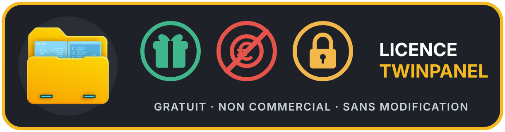

# TwinPanel

**Français** · [English](README.en.md)

Gestionnaire de fichiers à deux panneaux, gratuit, moderne et complet. Windows pour l'instant, Linux ensuite. Interface en français et en anglais.

- Deux panneaux, onglets, vue rapide, arborescence, miniatures, vue à plat
- Copie et déplacement avec file de transferts, reprise après coupure, contrôle de la place libre
- Serveurs SFTP, SCP, FTP, FTPS et WebDAV, utilisés comme des dossiers
- Archives zip, 7z, tar, tar.gz modifiables, zip chiffré AES-256
- Recherche, doublons, comparaison, synchronisation avec profils
- Renommage multiple, aussi selon les médias
- Thème clair ou sombre, raccourcis, couleurs et barre de boutons personnalisables

**[Télécharger TwinPanel](../../releases/latest)** (installateur pour Windows).

> **Message « Windows a protégé votre ordinateur » :** TwinPanel est gratuit et n'est pas signé, car un certificat de signature est payant chaque année. Windows affiche donc ce message tant que le programme n'est pas assez connu. Cliquez sur **Informations complémentaires**, puis sur **Exécuter quand même**. Vérifiez que le fichier vient bien de cette page ; son empreinte SHA-256 est donnée avec chaque version.

Pour demander une fonction ou signaler un problème : ouvrez une [« Issue »](../../issues) sur la page GitHub de TwinPanel. Voir [`CONTRIBUTING.md`](CONTRIBUTING.md).

## À l'origine de ce projet (Pourquoi et comment ?)

Ce logiciel est né d'un besoin très personnel. Depuis 2003, j'utilise au quotidien l'excellent logiciel **Total Commander**, que je trouve absolument génial. Cependant, pour mon utilisation précise, certaines fonctionnalités me manquaient ou n'étaient pas totalement optimales.

J'ai donc décidé de créer **TwinPanel**, à la base uniquement pour mon usage personnel et celui de ma femme. Après l'avoir montré à des amis qui ont souhaité le tester, ces derniers m'ont vivement conseillé de le partager et de le mettre à disposition d'autres utilisateurs potentiels, car il pourrait rendre de grands services — et ce, malgré l'existence d'autres projets similaires sur le marché.

### Une totale transparence avec vous :

Je tiens à être 100 % honnête avec tout le monde : **je n'y connais absolument rien en programmation et je ne parle pas d'autre langue que le français**.

**TwinPanel** a pu voir le jour, être entièrement codé et traduit en anglais grâce à l'aide de l'intelligence artificielle **Claude Code**. L'IA m'a accompagné pas à pas pour traduire mes besoins en lignes de code et pour générer la version anglaise du logiciel afin qu'il soit accessible au plus grand nombre.

Le programme est partagé ici tel quel, de bon cœur, dans le seul but d'être utile. Il est entièrement gratuit, mais comme vous pourrez le lire dans la section Licence ci-dessous, il reste protégé pour garantir qu'il ne soit jamais commercialisé ou dénaturé.

Bienvenue à tous les futurs utilisateurs de TwinPanel !

## Guide

Ce qui suit est le guide complet. C'est le même texte que dans le programme (touche **F1**).

<!-- guide -->
## Prise en main

TwinPanel montre deux dossiers côte à côte : on travaille dans le **panneau actif**, celui qui a le contour bleu, et la plupart des opérations visent l'**autre panneau**.

### L'écran

- En haut : la barre d'outils. Le bouton **≡** donne accès à toutes les commandes.
- Dans chaque panneau : les lecteurs et connexions, les onglets, le chemin, puis la liste des fichiers.
- En bas : la ligne de commande et les touches F3 à F8, cliquables.
- Les transferts en cours s'affichent juste au-dessus de la ligne de commande.

### Les cinq gestes à connaître

| Geste | Résultat |
|---|---|
| `Tab` | Changer de panneau |
| `Entrée` ou double-clic | Ouvrir un dossier ou un fichier |
| `Retour arrière` | Revenir au dossier parent |
| `Inser` ou clic droit court | Marquer un fichier |
| `F5` / `F6` | Copier / déplacer les fichiers marqués vers l'autre panneau |

Si rien n'est marqué, les opérations portent sur le fichier sous le curseur.

Pour aller plus vite vers un fichier, tapez simplement les premières lettres de son nom (`Échap` pour annuler).

## La souris

TwinPanel se pilote entièrement à la souris. Plusieurs gestes ne se devinent pas : voici la liste complète.

### Dans la liste des fichiers

| Geste | Résultat |
|---|---|
| Clic gauche | Choisir la ligne |
| Double-clic | Ouvrir le dossier ou le fichier |
| Clic sur le nom de la ligne déjà choisie | Renommer dans la liste (`Entrée` : valider, `Échap` : annuler) |
| Ctrl + clic | Marquer un élément |
| Maj + clic | Marquer une plage d'éléments |
| Clic droit court | Marquer ou démarquer l'élément |
| Bouton droit maintenu en glissant | Marquer ou démarquer tout ce que la souris survole |
| Bouton droit maintenu ½ seconde | Ouvrir le menu de l'élément |
| Clic milieu sur un dossier | L'ouvrir dans un nouvel onglet, en arrière-plan |
| Double-clic dans le vide | Revenir au dossier parent |
| Boutons latéraux | Dossier précédent / suivant |
| Ctrl + molette | Texte plus grand ou plus petit (en miniatures : taille des images) |
| Ctrl + clic milieu | Revenir à la taille normale |

Le clic sur le nom se désactive dans Options → Comportement.

### Glisser-déposer

Maintenez le bouton gauche sur un élément et déplacez la souris. Si l'élément est marqué, tous les éléments marqués partent avec lui.

Vous pouvez le lâcher sur un dossier, sur l'autre panneau, sur un onglet, sur un bouton de lecteur ou de connexion, ou dans l'Explorateur de Windows. Depuis l'Explorateur, le chemin inverse marche aussi.

| Au lâcher | Résultat |
|---|---|
| Sans touche | Menu « Copier ici / Déplacer ici » |
| Maj maintenue | Déplacer |
| Ctrl maintenue | Copier sans demander |

### Onglets et colonnes

| Geste | Résultat |
|---|---|
| Clic milieu sur un onglet | Le fermer |
| Clic droit sur un onglet | Dupliquer, renommer, verrouiller, fermer, supprimer les doublons |
| Glisser un onglet | Le ranger ailleurs, ou l'envoyer dans l'autre panneau |
| Molette sur les onglets | Faire défiler les onglets |
| Clic sur un titre de colonne | Trier par cette colonne |
| Glisser un titre de colonne | Changer l'ordre des colonnes |
| Clic droit sur les titres | Choisir les colonnes affichées |
| Clic droit sur le bouton Précédent | Dossiers récents |

## Le clavier

Tous les raccourcis se changent dans Options → Raccourcis. Dans le programme, la liste ci-dessous montre ceux réellement en vigueur.

<!-- raccourcis -->
### Navigation

| Touche | Action |
|---|---|
| `Tab` | Changer de panneau |
| `Entrée` | Ouvrir |
| `Retour arrière` | Dossier parent |
| `Ctrl+T` / `Ctrl+W` | Nouvel onglet / fermer l'onglet |
| `Ctrl+Tab` / `Ctrl+Maj+Tab` | Onglet suivant / précédent |
| `Alt+←` / `Alt+→` | Dossier précédent / suivant |
| `Alt+↓` | Dossiers récents |
| `Ctrl+Maj+J` | Jeux d'onglets |
| `Ctrl+PgUp` / `Ctrl+\` | Dossier parent / racine |
| `Ctrl+D` | Favoris |
| `Ctrl+L` | Modifier le chemin |
| `Ctrl+H` | Fichiers cachés |
| `Ctrl+F3` à `Ctrl+F6` | Trier par nom / extension / date / taille |
| `Ctrl+U` | Échanger les panneaux |
| `Ctrl+Maj+O` | Même dossier dans l'autre panneau |
| `Ctrl+Maj+←` / `→` | Ouvrir le dossier dans l'autre panneau |
| `Ctrl+R` | Rafraîchir |
| `Ctrl+B` | Vue à plat |
| `Ctrl+Q` | Vue rapide |
| `Ctrl+F8` | Arborescence |
| `Ctrl+Maj+F1` | Miniatures |
| `F12` / `Ctrl+F12` | Terminal intégré : afficher ou masquer / nouveau terminal |
| `Ctrl+Maj+F12` | Deux terminaux côte à côte |
| `Alt+F12` | Changer de côté dans le terminal |
| `Ctrl+Maj+F` | Dans le terminal : chercher dans le texte |

### Marquage

| Touche | Action |
|---|---|
| `Inser` | Marquer et descendre |
| `Espace` | Marquer (calcule la taille d'un dossier) |
| `Maj+↑` / `Maj+↓` | Marquer en se déplaçant |
| `Num+` / `Num-` | Marquer / démarquer selon un masque |
| `Num*` | Inverser le marquage |
| `Alt+Num+` | Marquer la même extension |
| `Ctrl+A` / `Ctrl+Maj+A` | Tout marquer / tout démarquer |

### Opérations

| Touche | Action |
|---|---|
| `F1` | Ce guide |
| `F3` | Voir |
| `Alt+F3` | Ouvrir avec l'application associée |
| `F4` | Éditer |
| `Maj+F4` | Nouveau fichier texte |
| `F5` / `F6` | Copier / déplacer |
| `Maj+F6` | Renommer |
| `Ctrl+M` | Renommage multiple |
| `Ctrl+Z` | Annuler le dernier renommage multiple |
| `F7` | Nouveau dossier |
| `F8` / `Suppr` | Supprimer |
| `Alt+Entrée` | Propriétés |
| `Alt+F5` / `Alt+F9` | Créer une archive / extraire |
| `Ctrl+Entrée` / `Ctrl+Maj+Entrée` | Nom / chemin dans la ligne de commande |
| `Ctrl+Maj+C` / `Ctrl+Alt+C` | Copier les chemins / les noms |
| `Ctrl+Maj+T` | Ouvrir un terminal ici |

### Recherche et connexions

| Touche | Action |
|---|---|
| `Alt+F7` | Rechercher |
| `Maj+F2` | Comparer les dossiers |
| `Ctrl+Maj+F2` | Comparer le contenu de deux fichiers |
| `Ctrl+Maj+S` | Synchroniser les dossiers |
| `Ctrl+F` | Gestionnaire de connexions |
| `Ctrl+N` | Connexion rapide |
| `Ctrl+Maj+F` | Déconnecter le panneau actif |

### Visionneuse et éditeur

| Touche | Action |
|---|---|
| `N` / `P` (visionneuse) | Fichier suivant / précédent |
| `1` `2` `3` `4` (visionneuse) | Texte, hexa, image, infos média |
| `Ctrl+F` (visionneuse) | Chercher |
| `Ctrl+S` (éditeur) | Enregistrer |
| `Ctrl+F` / `F3` (éditeur) | Rechercher / suivant |
| `Ctrl+H` (éditeur) | Remplacer partout |
| `Ctrl+G` (éditeur) | Aller à la ligne |
<!-- /raccourcis -->

## Onglets et vues

Chaque panneau a ses onglets : `Ctrl+T` pour en ouvrir un, `Ctrl+W` pour le fermer. Ils sont rouverts au démarrage suivant, y compris ceux sur un serveur (Options → Démarrage).

### Verrouiller un onglet

Clic droit sur l'onglet :

- **Verrouiller cet onglet** : aller ailleurs ouvre un nouvel onglet.
- **Verrouiller avec changement de dossier** : vous pouvez naviguer, et l'onglet revient à son dossier quand vous le reprenez.

### Jeux d'onglets

`Ctrl+Maj+J` ou ≡ → Onglets : enregistrez les onglets des deux panneaux sous un nom, puis rappelez-les d'un clic.

### Vues

- **Vue rapide** (`Ctrl+Q`) : l'autre panneau montre le fichier sous le curseur.
- **Arborescence** (`Ctrl+F8`) : l'arbre des dossiers à côté de la liste.
- **Miniatures** (`Ctrl+Maj+F1`) : images et vidéos sur le PC, images sur un serveur (chaque onglet a son mode).
- **Vue à plat** (`Ctrl+B`) : tous les fichiers des sous-dossiers, sur le PC et sur un serveur. `Échap` arrête la lecture.

Le tri par taille (`Ctrl+F6`) classe aussi les dossiers dont la taille est connue : calculée automatiquement (option **Taille des dossiers**) ou avec la barre d'espace. Les dossiers restent avant les fichiers.

## Marquer et travailler sur les fichiers

### Marquer

Marquez avec `Inser`, `Espace`, `Maj+flèches`, le clic droit, ou selon un masque avec `Num+` : `*.jpg;*.png` choisit deux types, `*.* | *.tmp` choisit tout sauf les `.tmp`.

### Copier et déplacer

`F5` copie, `F6` déplace. La fenêtre permet de changer la destination et de choisir quoi faire si un élément existe déjà : demander, écraser, écraser les plus anciens, ignorer, ou garder les deux.

- Le nombre de transferts en même temps se règle dans Options → Comportement (1 par défaut) : les suivants attendent leur tour.
- Un transfert peut être mis en pause, repris ou annulé.
- S'il n'y a plus de place, TwinPanel s'arrête sur le fichier en cause. Libérez de la place puis cliquez sur **Reprendre**.

### Voir, éditer, supprimer

- `F3` ouvre la visionneuse intégrée : texte, hexa, image, infos média.
- `F4` ouvre l'éditeur choisi, le Bloc-notes par défaut. Un éditeur intégré est aussi disponible, et chaque extension peut avoir son éditeur (Options → Éditeurs).
- `F8` envoie à la corbeille de Windows. Sur un serveur ou dans une archive, la suppression est définitive et toujours confirmée.

### Renommage multiple

`Ctrl+M` montre le résultat avant de renommer. Le masque du nom accepte `[N]` nom, `[N1-3]` trois premières lettres, `[C]` compteur, `[YMD]` date, `[h][m][s]` heure, `[P]` dossier. Rechercher / remplacer accepte les expressions régulières. `Ctrl+Z` annule le dernier renommage multiple.

### Propriétés

`Alt+Entrée` montre la taille réelle, les dates, les droits, le propriétaire et le groupe sur un serveur ou sous Linux, les attributs et la sécurité NTFS sous Windows, et les tags des médias.

## Rechercher, comparer, synchroniser

### Recherche

`Alt+F7` cherche par nom, texte contenu, taille et date, dans plusieurs dossiers et sur les serveurs ouverts. La case **Doublons** trouve les fichiers au contenu identique.

Sur un serveur, les tailles sont comparées d'abord. En SSH, le serveur calcule lui-même les empreintes, sans rien transférer. Sinon, TwinPanel annonce le volume à lire et demande votre accord.

### Comparaison

- `Maj+F2` compare les deux panneaux et marque les différences.
- `Ctrl+Maj+F2` compare le contenu de deux fichiers.
- ≡ → Outils : créer et vérifier des sommes de contrôle MD5, SHA-1 et SHA-256.

### Synchronisation

`Ctrl+Maj+S` ouvre la synchronisation. Choisissez les dossiers et le sens, cliquez sur **Comparer**, vérifiez la liste, puis lancez. Cliquez sur une flèche pour changer l'action d'une ligne. Rien n'est copié sans cette étape.

Un **profil** garde les dossiers, le sens et les options.

## Serveurs

TwinPanel se connecte en SFTP, SCP, FTP, FTPS et WebDAV. Un serveur s'utilise comme un dossier : `F5` envoie ou télécharge, y compris d'un serveur à l'autre.

### Se connecter

- `Ctrl+N` : connexion rapide, par exemple `utilisateur@192.168.0.10`, `ftps://…` ou `https://…/remote.php/dav/files/moi`.
- `Ctrl+F` : gestionnaire de connexions, avec fiches, groupes, clés SSH, identités, serveurs connus et coffre.
- Un bouton dans la barre des lecteurs ouvre chaque connexion enregistrée.
- Les connexions de FileZilla, WinSCP, PuTTY, OpenSSH et Total Commander s'importent.
- Un serveur inaccessible directement passe par un **serveur de rebond**, choisi dans sa fiche. Ce rebond peut lui-même passer par un autre, jusqu'à 8 à la suite. L'empreinte de chaque serveur est contrôlée.

### Sécurité

Les mots de passe enregistrés sont chiffrés dans un coffre lié à votre compte Windows, avec un mot de passe maître facultatif. L'export des connexions ne contient aucun secret.

À la première connexion SSH, comparez l'empreinte du serveur avant de l'accepter. Si elle change ensuite, TwinPanel bloque la connexion et vous prévient.

### Fichiers sur un serveur

`F4`, `Entrée` ou un double-clic ouvrent une copie sur le PC. À chaque enregistrement, TwinPanel propose de la renvoyer sur le serveur (ou sans demander : Options → Comportement).

### Transfert coupé

TwinPanel retente tout seul (3 fois par défaut), puis propose **Reprendre**. La reprise repart de l'endroit atteint en SFTP, et en FTP / FTPS ou en téléchargement WebDAV si le serveur l'accepte. Sinon, le fichier en cours repart de zéro. Les fichiers déjà terminés ne sont jamais renvoyés.

Si TwinPanel a été fermé pendant un transfert, il propose au démarrage suivant **Reprendre**, **Plus tard** ou **Oublier**. Pour y revenir : ≡ → Connexions → Transferts non terminés.

## Archives

`Entrée` ouvre une archive comme un dossier. `Retour arrière` en sort.

| Format | Possible |
|---|---|
| zip, 7z, tar, tar.gz | Lire, extraire, modifier |
| rar, gz, bz2, xz | Lire et extraire |
| zip chiffré | Lire, extraire, modifier avec son mot de passe |
| 7z chiffré | Lire et extraire seulement |

| Touche | Action |
|---|---|
| `F5` (dans une archive) | Extraire vers l'autre panneau |
| `F6` (dans une archive) | Déplacer hors de l'archive |
| `F5` / `F6` vers une archive ouverte | Ajouter dans l'archive |
| `Maj+F6`, `F7`, `F8` | Renommer, créer un dossier, supprimer |
| `Alt+F9` | Extraire toute l'archive à côté d'elle |
| `Alt+F5` | Créer une archive (.zip, .tar, .tar.gz), avec mot de passe en option |

Une archive modifiée est réécrite à côté, relue, puis elle remplace l'original : il faut de la place libre, et c'est long sur les gros fichiers.

Le mot de passe d'une archive reste en mémoire jusqu'à la fermeture de TwinPanel et n'est enregistré nulle part. Dans un zip chiffré, le contenu est protégé, mais les noms des fichiers restent visibles.

## Médias

### Infos et tags

- Colonnes facultatives : durée, résolution, codec vidéo, langues audio (clic droit sur les titres des colonnes).
- `F3` puis `4` : rapport complet d'une vidéo, d'une musique ou d'une photo.
- `Alt+Entrée` : modifier les tags des musiques et des MP4.

Deux outils facultatifs, à installer soi-même, ajoutent des possibilités : **mkvpropedit** (pistes des MKV) et **exiftool** (EXIF des photos). Leur chemin se règle dans Options → Affichage.

### Renommer selon les médias

Dans `Ctrl+M`, sur les fichiers du PC : `[Titre]`, `[Artiste]`, `[Album]`, `[Piste]`, `[Année]`, `[Genre]`, `[Résolution]`, `[Durée]`, `[Date de prise de vue]`. Un fichier sans cette valeur garde son nom. Les noms anglais marchent aussi : `[Title]`, `[Artist]`…

## Terminal

Un vrai terminal dans le bas de la fenêtre, écrit pour TwinPanel : les couleurs, `vim`, `nano` et `htop` y fonctionnent.

### L'ouvrir

- `F12` ouvre le panneau. Si le clavier est déjà dans le terminal, `F12` le masque : les terminaux continuent de tourner.
- Le bouton **Terminal** de la barre du haut déroule un menu : afficher ou masquer, nouveau terminal, dupliquer, un programme de ton PC ou un de tes serveurs SFTP / SCP.
- `Ctrl+F12` ouvre un autre terminal, dans un nouvel onglet. Le bouton **+** après les onglets propose tes programmes et tes serveurs SFTP / SCP.
- Le bouton **⧉** d'un onglet le duplique : même programme ou même serveur, dans son dossier de départ. La copie porte un numéro dans son onglet, par exemple `serveur (2)`. Le clic droit sur un onglet propose aussi **Dupliquer** ; en côte à côte, tu choisis le côté de la copie.
- Le bouton **Côte à côte** ou `Ctrl+Maj+F12` montre deux terminaux ensemble, avec une séparation à tirer. Chaque côté a ses onglets et son bouton **+**. S'il n'y a qu'un terminal, le second est sa copie. Clique dans un côté pour le rendre actif : il reçoit le clavier et les commandes enregistrées. `Alt+F12` passe d'un côté à l'autre. La largeur de la séparation est mémorisée. Le clic droit sur un onglet propose aussi **Déplacer** vers l'autre côté. En revenant à un seul côté, tous les terminaux restent ouverts.
- Le terminal démarre dans le dossier du panneau actif.
- Sur un serveur SFTP ou SCP, il ouvre un shell sur ce serveur, avec les mêmes identifiants, le même rebond et le même contrôle du serveur que le panneau.
- Tire la séparation au-dessus du terminal pour changer sa hauteur : TwinPanel s'en souvient.

Quand le clavier est dans le terminal, les touches vont au programme qui y tourne : `F5`, `F8` ou `Ctrl+W` n'agissent pas sur les fichiers. Seuls les raccourcis du terminal restent actifs.

### Copier et coller

- `Ctrl+C` copie le texte sélectionné. Sans sélection, il interrompt le programme, comme dans tout terminal.
- `Ctrl+V` colle, toujours. `Ctrl+Maj+C`, `Ctrl+Maj+V` et `Maj+Inser` marchent aussi.
- Clic droit : copie la sélection, ou colle s'il n'y a rien de sélectionné.
- Double-clic : un mot. Triple-clic : une ligne.
- Si un programme utilise la souris, garde `Maj` enfoncée pour sélectionner du texte.
- Avant de coller plusieurs lignes dans un programme qui les exécuterait aussitôt, TwinPanel demande confirmation. Le texte collé perd ses caractères de contrôle, et un dernier retour à la ligne ne lance rien.

Quand le clavier est dans le terminal, toutes les touches vont au programme qui y tourne : `F5` ne copie pas de fichier. Seuls `F12` et `Alt+F4` restent à TwinPanel. Clique sur une liste pour revenir aux fichiers.

### Commandes enregistrées

Le bouton **Commandes** affiche ou cache un panneau à droite du terminal.

- **Ajouter** : donne un nom et écris la commande, telle qu'elle doit être envoyée.
- **Exécuter** lance la commande dans le terminal affiché. **Copier** la met dans le presse-papiers.
- **Demander avant de lancer** : une confirmation, utile pour `rm` ou `reboot`.
- **Seulement sur ce serveur** : la commande n'apparaît que sur ce serveur. Sinon, elle apparaît partout.

Les commandes sont enregistrées en clair dans tes réglages : n'y mets jamais de mot de passe.

### Remonter dans le texte

La molette ou `Maj+PgPréc` / `Maj+PgSuiv` remontent dans les 10 000 dernières lignes de chaque terminal. Ce texte reste en mémoire et n'est jamais écrit sur le disque. Il disparaît à la fermeture.

Si un serveur envoie du texte beaucoup plus vite que l'affichage, TwinPanel saute une partie du milieu et le signale par une ligne : il reste réactif et `Ctrl+C` agit tout de suite.

### Chercher dans le texte

`Ctrl+Maj+F` dans un terminal ouvre une barre de recherche, ou **Chercher dans le terminal** dans le menu du bouton Terminal. Le mot est cherché sans tenir compte des majuscules, dans tout le texte de ce terminal, et le résultat s'affiche sélectionné. `Entrée` remonte vers le plus ancien, `Maj+Entrée` redescend, `Échap` ferme la barre. `Ctrl+C` copie le résultat une fois la barre fermée.

### Réglages

**Options → Terminal** : le programme lancé (PowerShell par défaut, parmi ceux installés sur ton PC), la taille du texte, et une case pour désactiver complètement le terminal intégré.

La commande `Ctrl+Maj+T` reste disponible : elle ouvre le terminal de ton choix dans sa propre fenêtre.

## Personnaliser

Tout se règle dans ≡ → Outils → Options.

| Page | Contenu |
|---|---|
| Affichage | Langue, thème, police, colonnes, formats, miniatures, outils médias |
| Couleurs | Couleurs par type de fichier, règles par masque, icônes des disques |
| Comportement | Corbeille, confirmations, transferts en même temps, astuces |
| Démarrage | Onglets à rouvrir, dossiers de départ |
| Raccourcis | Toutes les touches, avec recherche |
| Barre de boutons | Vos programmes, dossiers et commandes |
| Menu Démarrer | Votre menu personnel, avec sous-menus |
| Éditeurs | Éditeur par extension |
| Terminal | Terminal à ouvrir |
| Sauvegarde | Tous les réglages dans un seul fichier |

Paramètres des boutons et du menu : `%P` dossier actif, `%N` nom de l'élément, `%F` son chemin complet, `%T` dossier de l'autre panneau, `%S` éléments marqués.

## Questions fréquentes

### Comment changer la langue ?

Options → Affichage → Langue. TwinPanel propose de redémarrer. Au premier lancement, il suit la langue de Windows.

### Je ne retrouve pas une fonction.

Le bouton **≡** contient toutes les commandes. Options → Raccourcis permet aussi de chercher une commande par son nom, et ce guide a un champ de recherche.

### Comment annuler une suppression ?

Sous Windows, `F8` envoie à la corbeille : restaurez le fichier depuis celle-ci. Sur un serveur ou dans une archive, il n'y a pas de corbeille. `Ctrl+Z` annule seulement le dernier renommage multiple.

### Où sont mes réglages ?

Dans `%APPDATA%\TwinPanel`. Une mise à jour n'y touche pas.

### Comment passer sur un autre PC ?

Options → Sauvegarde crée un seul fichier avec tous les réglages, et la liste des connexions si vous le souhaitez. Les mots de passe n'y sont jamais : ils seront redemandés.

### Mes mots de passe sont-ils en sécurité ?

Ils sont chiffrés, jamais écrits en clair, et seul votre compte Windows sur ce PC peut les lire. Un mot de passe maître ajoute une deuxième protection.

### J'ai oublié mon mot de passe maître.

Il ne peut pas être récupéré : les mots de passe et les clés du coffre sont perdus. Vos connexions restent. Pour repartir d'un coffre vide, fermez TwinPanel et supprimez `secrets.dat` dans `%APPDATA%\TwinPanel`.

### J'ai modifié un fichier d'un serveur, mais le serveur n'a pas changé.

Le fichier s'ouvre depuis une copie sur le PC. Enregistrez-le dans votre programme, puis répondez **Renvoyer** à la question de TwinPanel. Sans renvoi, la modification reste sur le PC.

### Pourquoi je ne peux pas modifier cette archive ?

rar, gz, bz2 et xz sont en lecture seule, comme les 7z chiffrés. Extrayez le contenu, puis créez une nouvelle archive avec `Alt+F5`.

### F4 n'ouvre pas le bon éditeur.

Choisissez-le dans ≡ → Outils → Éditeur et visionneuse, ou par extension dans Options → Éditeurs. Si l'éditeur choisi n'existe plus, TwinPanel le signale et utilise le Bloc-notes.

### Comment afficher les fichiers cachés ?

`Ctrl+H`, ou le bouton de la barre d'outils.

### Pourquoi les copies se font-elles l'une après l'autre ?

C'est le réglage par défaut. Augmentez « Transferts en même temps » dans Options → Comportement.

### Comment demander une fonction ou signaler un problème ?

Ouvrez une « Issue » sur la page GitHub de TwinPanel. Décrivez ce que vous avez fait et ce que vous attendiez. Rien n'est envoyé automatiquement depuis le programme.

### Puis-je l'utiliser au travail ?

Oui, gratuitement, aussi en entreprise. Il est seulement interdit de le vendre, le louer ou l'intégrer dans une offre payante. Voir la licence.
<!-- /guide -->

## Compiler

Il faut le SDK .NET 10.

- `build.bat` : compile tout, lance les tests, écrit le résultat dans `build.log`.
- `run.bat` : lance l'application.
- Ou : `dotnet run --project src/TwinPanel.App`

| Projet | Rôle |
|---|---|
| `src/TwinPanel.Core` | Logique sans interface, testable |
| `src/TwinPanel.App` | Interface Avalonia |
| `tests/TwinPanel.Core.Tests` | Tests xUnit |

Composants utilisés et plan du code : `COMPOSANTS.md`.

## Licence

TwinPanel est publié sous la **Licence TwinPanel 1.0** — © 2026 Georges Christophe (chrypox). Le texte complet, seul à faire foi, est dans le fichier [`LICENSE`](LICENSE). En résumé :

- **Gratuit** : utilisation libre et gratuite, aussi en entreprise et en interne ; interdit de le vendre, le louer ou l'intégrer dans une offre payante.
- **Partage** : seulement la version d'origine, complète, gratuitement et avec la licence.
- **Sans modification diffusée** : chacun peut modifier le code pour son propre usage, mais ne peut pas diffuser de version modifiée ni réutiliser le code dans un autre projet.
- **Plugins** : autorisés s'ils sont gratuits et ne contiennent pas le code de TwinPanel.
- **Corrections** : proposées par une « Issue » (ticket) ; l'auteur les intègre lui-même, en créditant leur auteur.
- **Droits d'autrui** : un élément qui ne respecterait pas une licence ou vos droits ? Écrivez à admin@chrypox.be.

Ce n'est pas une licence Creative Commons. Les bibliothèques d'autres développeurs livrées avec TwinPanel restent sous leur propre licence : voir [`THIRD-PARTY-NOTICES.md`](THIRD-PARTY-NOTICES.md) (et, dans le programme, **À propos → Bibliothèques utilisées et leurs licences**).
